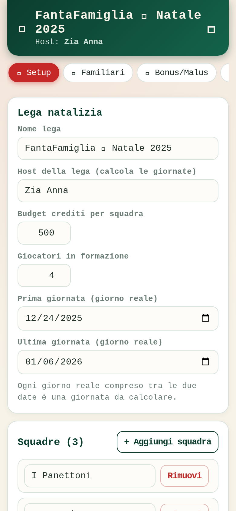
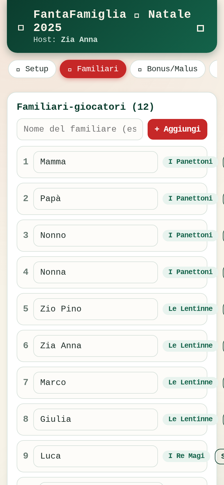
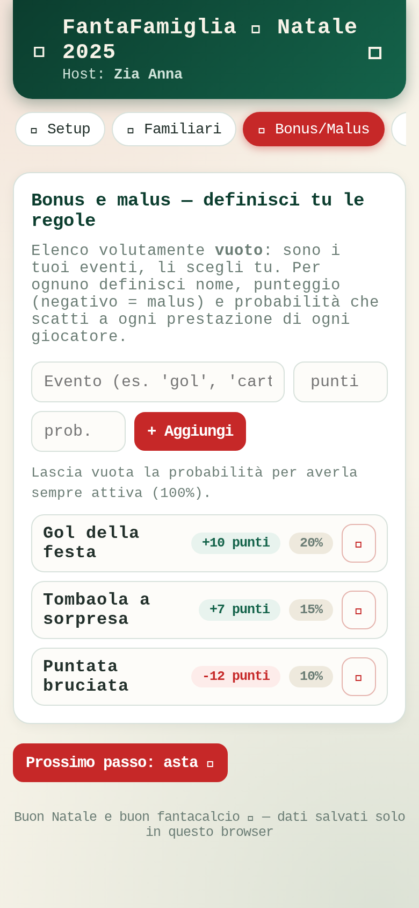
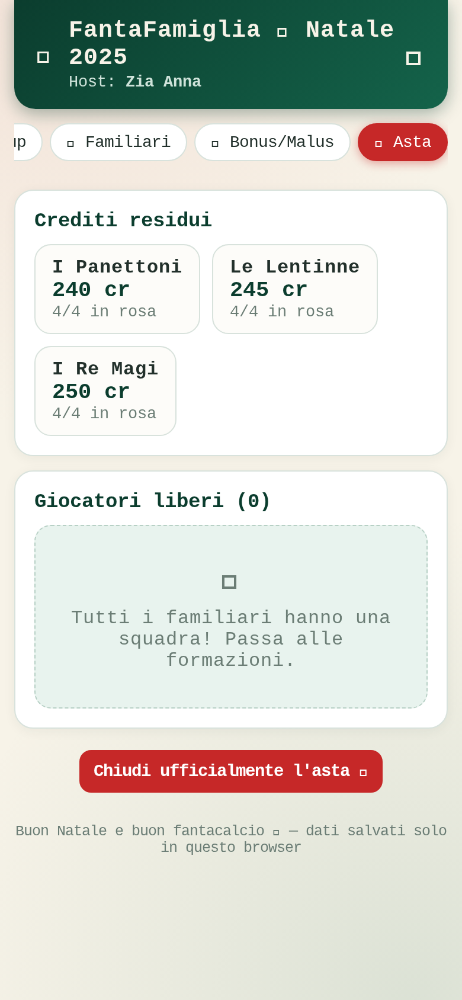
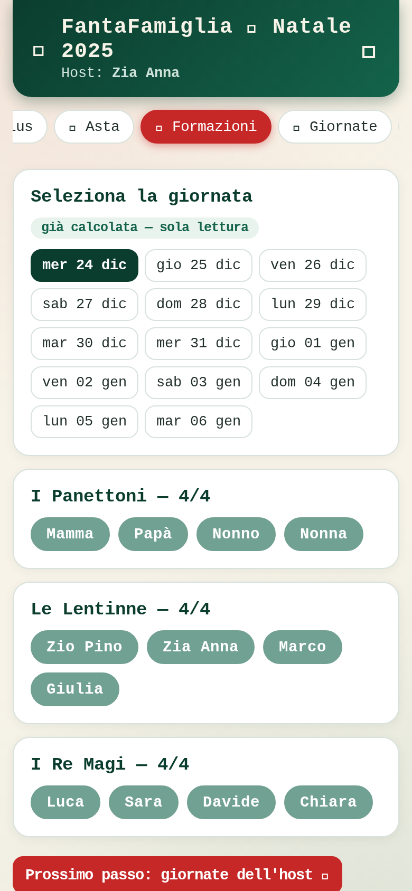
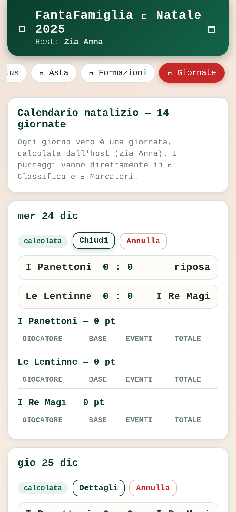
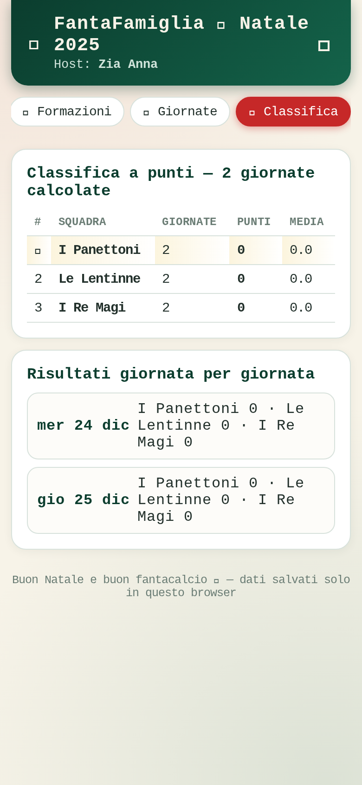
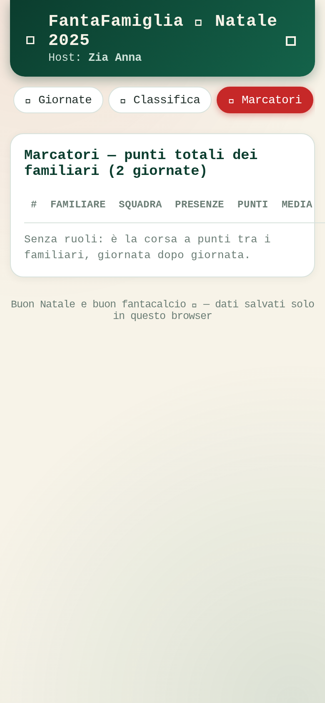

# FantaNatale ⚽🎄

Fantacalcio di famiglia: i **giocatori sono i tuoi familiari**. Niente ruoli, **formazioni da 4**
(dimensione configurabile), **asta con crediti**, **bonus e malus definiti da te**, e una regola
speciale: **ogni giorno reale del periodo natalizio è una giornata**, calcolata dall'host della lega.

L'app gira **interamente nel browser**: nessun server, nessun account, nessun LLM chiamato.
I dati vivono nel `localStorage` del dispositivo.

## Flusso di gioco (fasi dell'app)

1. ⚙️ **Setup** — nome lega, host, budget crediti, dimensione formazione, date del periodo natalizio,
   squadre (numero e nomi a piacere), regole di simulazione.
2. 🎅 **Familiari** — inserisci i tuoi familiari (i 12 di famiglia). Nessun nome predefinito.
3. ⭐ **Bonus/Malus** — elenco volutamente vuoto: definisci tu ogni evento (nome, punti — negativi
   per i malus — e probabilità che scatti). Il prototipo funziona anche senza alcun evento.
4. 🔨 **Asta** — lotto per lotto: base d'asta 1 credito, rilanci +1/+10 o offerta libera, vendita
   con addebito crediti e rimborso in caso di svincolo. Chiude quando finiscono i familiari o
   quando l'host chiude l'asta.
5. 📋 **Formazioni** — per ogni giornata scegli i 4 schierati per squadra; puoi copiare la
   formazione della giornata precedente (viene ereditata in automatico se non la cambi).
6. 📅 **Giornate** — il calendario genera un incontro per ogni giorno reale (andata/ritorno, gestisce
   anche un numero di squadre dispari con riposo). Solo l'host preme **Calcola giornata**.
7. 🏆 **Classifica** — somma dei punti di tutte le giornate calcolate.
8. 🥇 **Marcatori** — corsa a punti tra i familiari: presenze, totale, media, miglior giornata.

## Che punteggi genera la simulazione

A ogni giornata ogni familiare schierato riceve un punteggio base casuale tra *min* e *max*
(default 40–100, modificabili nel Setup); eventuali eventi bonus/malus scattano ciascuno con la
propria probabilità e si sommano. Il punteggio di una squadra è la somma dei suoi 4 schierati.
Nello scontro diretto vince chi fa più punti; la classifica generale è a punti totali.

## Avvio in locale

```bash
npm install
npm run dev        # sviluppo: apre su http://localhost:5173
npm run build      # build di produzione in dist/
npm run preview    # serve la build di produzione in locale
```

## Uso su più dispositivi

Non c'è un backend, quindi ogni dispositivo ha il suo stato. Per spostare o condividere la lega:

1. sul dispositivo di partenza: ⚙️ Setup → **Esporta lega (JSON)**;
2. sul dispositivo di arrivo: ⚙️ Setup → **Importa lega (JSON)**.

Se vuoi che tutti i dispositivi condividano la stessa lega in tempo reale serve un piccolo
backend sincronizzato — è una delle possibili prossime fasi, dimmelo e la aggiungiamo.

## Installazione come app (PWA)

Con la build pubblica (es. `npm run build` + un qualsiasi hosting statico, oppure GitHub Pages),
il browser propone **"Aggiungi alla schermata Home"** sia su Android sia su iOS: l'app si apre
a schermo intero come le altre, con icona ⚽🎄.

## Status

Prototipo funzionante. Da definire insieme (rimandato a domani): la lista finale dei bonus/malus
natalizi. La schermata ⭐ è già pronta per accoglierli.

## Screenshot (dati dimostrativi, non reali)

| | |
|---|---|
|  |  |
|  |  |
|  |  |
|  |  |
